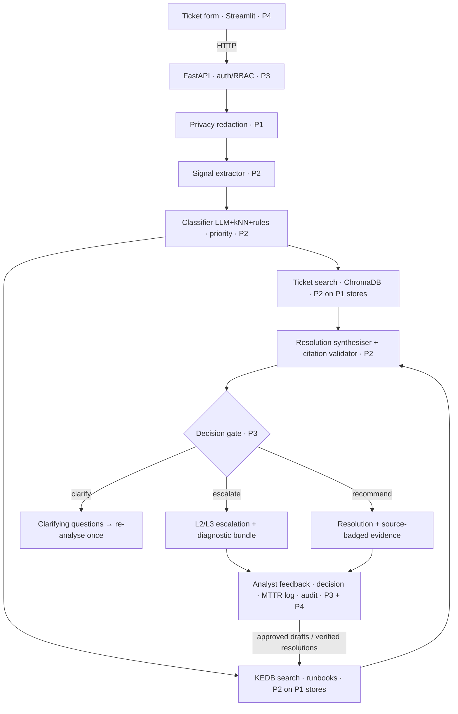

# IT Ticket Analysis & Resolution Assistant

> HCLTech Future Ready AI Engineer Hackathon · Use Case 1
> Analyses an incoming IT ticket, finds similar incidents, matches the Known Error Database (KEDB) and recommends an **evidence-backed** resolution. It then **recommends, asks for details, or escalates**. An analyst always reviews; the system never acts on its own.

**Stack:** Python 3.11 · FastAPI · Streamlit · Groq (free tier) · ChromaDB · sentence-transformers (`BAAI/bge-small-en-v1.5`) · SQLite
**Full design:** [`docs/architecture.md`](docs/architecture.md). Section numbers like "§7.3" in this README refer to that document.

---

## Table of contents

1. [What it does](#1-what-it-does)
2. [Output contract](#2-output-contract)
3. [Architecture at a glance](#3-architecture-at-a-glance)
4. [Repository layout and ownership](#4-repository-layout-and-ownership)
5. [Setup and run](#5-setup-and-run)
6. [Data](#6-data)
7. [Team split: who builds what](#7-team-split-who-builds-what)
8. [How we work in parallel](#8-how-we-work-in-parallel)
9. [Working with Claude Code](#9-working-with-claude-code)
10. [Git workflow](#10-git-workflow)
11. [Integration milestones](#11-integration-milestones)
12. [Testing](#12-testing)
13. [Configuration and environment](#13-configuration-and-environment)
14. [Requirement traceability](#14-requirement-traceability)
15. [Assumptions and trade-offs](#15-assumptions-and-trade-offs)
16. [Troubleshooting](#16-troubleshooting)
17. [Submission checklist](#17-submission-checklist)

---

## 1. What it does

```
Ticket ──► privacy redaction ──► signal extraction ──► classify + priority ──► similar incidents (ChromaDB)
                                                                           └─► KEDB match (runbooks)
        ──► cited resolution steps ──► decision gate: RECOMMEND | CLARIFY | ESCALATE
        ──► analyst review, feedback, decision ──► audit log + MTTR timing ──► (feeds KB / verified incidents)
```

- **Classifies** each ticket (category, subcategory, priority, intent) with an explainable confidence score.
- **Finds** similar and duplicate historical incidents, and says why each one matches.
- **Matches** curated KEDB runbooks, using exact error codes plus semantic and keyword search.
- **Recommends** ordered steps. **Every step cites** a KB step or a verified incident; a step with no citation is removed.
- **Decides** whether to recommend, ask a clarifying question (one round), or escalate to L2/L3 with a diagnostic bundle.
- **Records** everything (input, prediction, evidence, recommendation, reviewer decision) in a tamper-evident audit log.
- **Measures** handling time (MTTR), comparing assisted mode with a manual baseline in a timed trial.

---

## 2. Output contract

`POST /api/v1/analyze?view=contract` returns **exactly** this shape. The default `view=full` adds one extra key, `details`, which holds the evidence, citations, decision, reasons and timings (architecture §4.3).

```json
{
  "ticket_id": "INC1001",
  "classification": {"category": "Network", "subcategory": "VPN", "confidence": 0.94},
  "priority": {"level": "High", "reason": "Multiple users affected"},
  "similar_incidents": [
    {"incident_id": "INC0892", "similarity_score": 0.91, "resolution": "Restart VPN service"}
  ],
  "kedb_match": {"found": true, "error_code": "VPN_001", "solution": "Restart VPN service"},
  "recommended_solution": {
    "steps": ["Check VPN connectivity", "Restart VPN service", "Verify connection"],
    "source": "Historical Incident"
  },
  "escalation_required": false,
  "human_approval_required": true
}
```

| Field | Values / rule |
|-------|---------------|
| `priority.level` | `Critical` (P1) · `High` (P2) · `Medium` (P3) · `Low` (P4) |
| `kedb_match.error_code` | The KEDB known-error ID, e.g. `KB-0018`, or `null`. The literal code found in the ticket is in `details.kedb.matched_error_code`. |
| `recommended_solution.source` | `KEDB` · `Historical Incident` · `KEDB + Historical Incident` · `None` |
| `escalation_required` | `true` if the decision gate escalates any issue |
| `human_approval_required` | `true` if the decision isn't *recommend*, priority is High or Critical, a step needs admin/L2, confidence isn't high, the source is `None`, or the system is running degraded |

JSON Schema: [`shared/contract/analysis_output.schema.json`](shared/contract/analysis_output.schema.json). **CI fails if any response breaks it.**

---

## 3. Architecture at a glance



There are two processes: `uvicorn backend.main:app` on port 8000 and `streamlit run ui/app.py` on port 8501. The UI talks to the API **only over HTTP** (`ui/client.py`).

---

## 4. Repository layout and ownership

**Rule: you only edit files in folders you own.** Shared folders change only through the contract-change process (§8.3).

| Path | Owner | Contents |
|------|-------|----------|
| `shared/` | **ALL** (frozen after Phase 0) | Pydantic schemas, interfaces (Protocols), constants, stubs, JSON Schema, golden fixtures |
| `privacy/` | P1 | `redact.py`, the PII/secret redaction used offline and online |
| `ingest/` | P1 | enrichment (synthetic history), test-set builder, ChromaDB/BM25/error-code indexers |
| `store/` | P1 | `chroma_store.py`, `bm25_store.py`, `embedder.py`: the store API everyone queries |
| `eval/` | P1 | metrics, ablations, MTTR report |
| `data/seed/`, `data/test/` | P1 | curated verified incidents, test/trial tickets and gold labels |
| `ai/` | P2 | signals, splitter, classifier, priority, ticket search, KB search, synthesiser, validator, Groq client, prompts |
| `backend/` | P3 | FastAPI app, pipeline, decision gate, escalation, approval, access control, audit, feedback, MTTR, KB drafts, SQLite |
| `ui/` | P4 | Streamlit pages, API client, mock API |
| `trial/` | P4 | timed-trial schedule, protocol, raw results |
| `docs/examples/`, `README.md` | P4 | worked examples, final README |
| `docs/evaluation_report.md` | P1 | evaluation report |
| `docs/architecture.md` | ALL | design (contract-change process) |
| `config/` | per file | `data.yaml privacy.yaml taxonomy_map.yaml` → P1 · `ai.yaml rules.yaml signals.yaml` → P2 · `backend.yaml escalation.yaml kb_escalation_clauses.yaml clarify_templates.yaml users.yaml` → P3 · `ui.yaml` → P4 · `base.yaml` → ALL |
| `requirements/` | per file | `data.txt` P1 · `ai.txt` P2 · `backend.txt` P3 · `ui.txt` P4 · `base.txt dev.txt` ALL |
| `mk/` | per file | `p1.mk … p4.mk` (Make targets for each owner; the root `Makefile` includes them) |
| `tests/` | per folder | `p1_data/ p2_ai/ p3_backend/ p4_ui/` per owner · `contract/ integration/` ALL |

```
it-ticket-assistant/
├── shared/ privacy/ ingest/ store/ eval/ ai/ backend/ ui/ trial/
├── config/ data/{raw,processed,kb,samples,seed,test} docs/ tests/ requirements/ mk/
├── .github/{workflows/ci.yml, CODEOWNERS, pull_request_template.md}
├── Makefile  pyproject.toml  .env.example  CLAUDE.md  README.md
```

---

## 5. Setup and run

### 5.1 Prerequisites

- Python 3.11, git, make
- A Groq API key from the Groq console (free tier). **Optional**: everything runs in offline fallback mode without one.
- About 1.5 GB of disk for the embedding model and the Chroma index

### 5.2 First-time setup

```bash
git clone <repo-url> it-ticket-assistant && cd it-ticket-assistant
python3.11 -m venv .venv && source .venv/bin/activate      # Windows: .venv\Scripts\activate
make setup                     # pip install -r requirements.txt (+ dev), pre-commit hooks
cp .env.example .env           # add GROQ_API_KEY and APP_SECRET
make data                      # enrich history + build Chroma, BM25 and error-code indexes (about 3-6 min on CPU)
```

### 5.3 Run

```bash
make api        # FastAPI on http://localhost:8000  (OpenAPI docs at /docs)
make ui         # Streamlit on http://localhost:8501 (second terminal)
make demo       # runs the 7 demo tickets through the API and prints contract JSON
```

**No backend yet, or no data?** The UI runs against an in-memory mock that serves the golden fixtures:

```bash
MOCK_API=1 make ui                 # Windows PowerShell: $env:MOCK_API=1; make ui
make mock-api                      # or: the same mock as an HTTP server on :8000 for curl / make demo
```

Quick check with curl:

```bash
python -c "import json;print(json.dumps(json.load(open('data/samples/sample_tickets.json'))[0]))" \
| curl -s -X POST "http://localhost:8000/api/v1/analyze?view=contract" \
  -H "Content-Type: application/json" -H "X-Demo-Role: l2" -d @- | python -m json.tool
```

### 5.4 All Make targets

| Target | What it does | Owner |
|--------|--------------|-------|
| `setup` | install dependencies, pre-commit | ALL |
| `data` | `python -m ingest.build_all` (enrich → index tickets → index KEDB → manifest) | P1 |
| `data-eval` | build the `*_eval` collections from the 70% split | P1 |
| `test-sets` | regenerate `data/test/*.json` from the seed files | P1 |
| `api` | `uvicorn backend.main:app --reload --port 8000` | P3 |
| `ui` | `streamlit run ui/app.py` | P4 |
| `mock-api` | serve golden fixtures on port 8000 (for UI work without a backend) | P4 |
| `demo` | analyse DEMO-001…007, validate each against the contract, print a §16 ✓/✗ table | P4 |
| `examples` | regenerate `docs/examples/*.md` from the API (audit records) | P4 |
| `trial-schedule` | seeded crossover schedule → `trial/results/schedule.csv` (`PARTICIPANTS="a b c d"`) | P4 |
| `trial-export` | trial events → `trial/results/raw_events.csv` for `make mttr-report` (`TRIAL_USER=admin TRIAL_PASSWORD=…`) | P4 |
| `test` | all tests except `groq`/`slow` | ALL |
| `test-p1` … `test-p4` | one owner's tests | each |
| `test-contract` | validate outputs against the JSON Schema | ALL |
| `test-int` | end-to-end golden tests (needs `make data`) | ALL |
| `eval` | `python -m eval.run --split test` → `eval/out/` | P1 |
| `mttr-report` | `python -m eval.mttr_report` → `eval/out/mttr.json` + charts | P1 |
| `lint` / `fmt` | `ruff check .` / `ruff format .` | ALL |

### 5.5 Analyst UI tour (`make ui`)

| Page | What it is for | Requirement |
|------|----------------|-------------|
| **Login** (`ui/app.py`) | Pick a role (demo mode, "DEMO AUTH" badge) or log in; shows API / LLM / index health | access |
| **1 Analyze** | Ticket form or *Load sample* (demos, test and trial tickets). Cards for classification, priority, similar incidents (tier + `SYNTHETIC`/`VERIFIED` badge + why), KEDB match, cited steps (`[KB-0018·res.1]`, L1/L2, already-tried greyed out), decision banner (clarify answer box / escalation bundle download), approval badge, secondary-issue tab, JSON toggle. 👍 ✗ ? on every item and the final decision form. | FR-01…06 |
| **2 Manual mode** | Trial baseline: ticket text plus keyword search only, **no AI output**, the same decision form, hidden timer events | FR-09 |
| **3 Search & filter** | Query plus category, subcategory, priority, status, group, application, environment, source and date filters, with paging and a detail drawer | FR-07 |
| **4 Review queue** | Clarify, escalate and needs-approval items by priority and age; override labels and priority | FR-05 |
| **5 KB browser** | Articles with citable step IDs, coverage gaps, drafts and approval (kb_owner) | FR-03/06 |
| **6 Audit view** | Timeline, evidence, decision and feedback, hash-chain status, masked export, worked-example download | FR-08 |
| **7 MTTR dashboard** | TTD/TTR/MTTR by category, priority, mode and decision; trial manual vs assisted; feedback; degraded; synthetic baseline | FR-09 |

UI rules: a step is never rendered without its source badge; synthetic data is always badged; every chip has a colour **and** a text label; `ui.viewed` is posted once per result. The timed trial is described in [`trial/protocol.md`](trial/protocol.md), worked examples are in [`docs/examples/`](docs/examples/), and the demo talk track is [`docs/examples/DEMO_SCRIPT.md`](docs/examples/DEMO_SCRIPT.md).

### 5.6 Windows notes

- No GNU make? Use `mingw32-make` (MinGW) or `choco install make`. Pass the venv interpreter when it is not activated: `make test-p4 PY=.venv/Scripts/python`.
- Without make: `python -m streamlit run ui/app.py`, `python -m ui.mock_api`, `python -m ui.demo`, `python -m pytest tests/p4_ui`. Run them from the repo root so `ui`, `shared` and the other packages import.
- Python 3.11 is the target (`pyproject.toml`). The UI and tests also run on 3.12 for local work.

---

## 6. Data

| File | Put it at | What it is |
|------|-----------|------------|
| `Dataset_ticket_4.xlsx` | `data/raw/` | 1,800 raw tickets (Italian). 5 categories, 18 subcategories, 100 each. |
| `tickets.json` | `data/processed/` | The same 1,800 tickets, translated to English with Groq. **Goes into ChromaDB.** `resolution` is null everywhere and `priority` is a fixed function of subcategory. |
| `articles.json` | `data/kb/` | **KEDB**: 30 runbooks (KB-0001…0030) with symptoms, error codes, diagnostics, resolution steps and escalation criteria |
| `sample_tickets.json` | `data/samples/` | **Input format** and the 7 demo tickets with gold labels in `metadata.expected_*` |
| Problem statement `.docx` | `docs/brief.docx` | Requirements FR-01…FR-08 |

These files are generated by P1 and **flagged as synthetic** (see §15):

| Generated file | Contents |
|----------------|----------|
| `data/processed/tickets_enriched.json` | Historical tickets plus synthetic `opened_at/resolved_at`, `assignment_group`, `application`, `environment`, `restricted`, and a KB-derived `resolution` (`resolution_origin=synthetic_kb_derived`, **never cited as evidence**) |
| `data/seed/resolved_incidents.json` | ~60 team-reviewed resolved incidents (`curated_verified`). These are the only historical items allowed as a `Historical Incident` source until analysts verify more in the app. |
| `data/test/test_tickets.json` | 7 demo tickets + ~25 candidate-created edge cases (gaps, vague, contradictory, security, PII, prompt injection, multi-issue) with gold labels |
| `data/test/trial_tickets.json` + `trial_gold.json` | 12 tickets for the timed MTTR trial (gold is kept separate and never sent to the UI) |

**Input format for a new ticket** is the `sample_tickets.json` schema:

```json
{"id": "DEMO-001", "title": "...", "description": "...", "category": null, "subcategory": null,
 "priority": null, "status": "new", "resolution": null, "metadata": {"source": "demo"}}
```

Optional: `application`, `environment`, `location`, `assignment_group`, `restricted`. The API **strips `metadata.expected_*`** before analysis so gold labels never leak into the models.

---

## 7. Team split: who builds what

Each person owns a vertical slice and **codes against the stubs in `shared/stubs.py`** until the real dependency lands (§8). Task IDs (e.g. `P2-T3`) are used in branch names, commits and PRs.

### P1 · Data & Knowledge Base

**Builds:** the ticket data (synthetic history, test tickets, KB articles), the privacy step that hides personal details, the ChromaDB/BM25/error-code loading, and the **evaluation report including MTTR results**.
**Gives others:** clean, searchable ticket and knowledge data through the `TicketStore`, `KBStore` and `embed()` APIs (architecture §6.6), plus `privacy.redact()`.
**Requirements:** data rules (synthetic data labelled), privacy, evaluation report, FR-09 reporting.

| ID | Task | Done when |
|----|------|-----------|
| P1-T1 | **Index first (unblocks P2):** `store/embedder.py`, `ingest/index_kedb.py` (field-level chunks, error-code index, BM25), `ingest/index_tickets.py` on the plain `tickets.json`, `store/chroma_store.py` + `bm25_store.py` implementing `shared/interfaces.py` | `make data` builds `tickets_hist` and `kedb_chunks`; `TicketStore.query()` and `KBStore.query_chunks()/lookup_codes()` pass `tests/p1_data/test_stores.py`; `indexes/manifest.json` is written |
| P1-T2 | `privacy/redact.py` + `config/privacy.yaml`: email, phone, IP, person, ID, secrets, tokens; stable placeholders; `secret_detected` | ≥ 30 test cases pass; `ORA-01013`, `0xc0000005` and `SQL Server error 18456` are **not** redacted |
| P1-T3 | `ingest/enrich.py` → `tickets_enriched.json` (§6.3.1, seed 42); re-index `tickets_hist` with the enriched metadata (dates as epoch ints, lists as CSV) | Every record has `derived_fields` and `resolution_origin`; FR-07 filters work in a Chroma `where` |
| P1-T4 | `data/seed/resolved_incidents.json`: ~60 curated incidents (3 per subcategory + 6 for gaps), Groq-drafted then **human-edited**; review checklist in `data/seed/README.md`; `tickets_verified` collection; `upsert_live()` and `mark_verified()` | All records pass the schema; none violate the KB safety rules; each has `verified_by` |
| P1-T5 | `config/taxonomy_map.yaml` (architecture §3.3) + `ingest/make_test_sets.py` → `data/test/test_tickets.json`, `trial_tickets.json`, `trial_gold.json`, `eval/gold/gold_kb.json` | Covers every edge-case category in architecture §6.3.3; gold labels for category, subcategory, priority, kb_ids and decision |
| P1-T6 | `reindex_article(kb_id)` + governance fields (`articles_governed.json`) | Approving a draft makes it searchable without a full rebuild |
| P1-T7 | `eval/run.py`, `eval/metrics.py`: 70/15/15 split, `*_eval` collections, every metric in architecture §14.2, ablations, `errors.jsonl`; tune the classifier weights and bands on the validation split and send the results to P2 | `make eval` produces `eval/out/metrics.json` + confusion matrices |
| P1-T8 | `eval/mttr_report.py`: reads `trial/results/raw_events.csv` and `ticket_events` → median TTD manual vs assisted, % change, correctness, n, caveats | Charts plus `eval/out/mttr.json` |
| P1-T9 | `docs/evaluation_report.md`: dataset, method, results, observed errors, limitations, synthetic-data statement | Reviewed by the whole team |

### P2 · AI Engine / RAG

**Builds:** the ticket classifier, the similar-ticket search and the resolution recommender that cites its evidence.
**Gives others:** `ai.engine.run(ticket, ctx) -> EngineResult` (labels with confidence scores, priority with drivers, similar tickets with the reason each matches, KB matches with excerpts, resolution steps that each cite a source), plus `search_tickets()` and `search_kb()` for FR-07.
**Requirements:** FR-01, FR-02, FR-03, FR-04.

| ID | Task | Done when |
|----|------|-----------|
| P2-T1 | `ai/llm/groq_client.py`: JSON mode, temperature 0, retry/backoff on 429, token bucket, SQLite cache, circuit breaker, `on_call` callback for P3's `llm_calls` audit; `offline` mode when there's no key | Unit tests with a fake HTTP layer; cache hit on the second identical call |
| P2-T2 | `ai/signals.py` + `config/signals.yaml` (architecture §7.1): error codes (incl. KEDB phrase codes from `KBStore.all_error_phrases()`), users/scope, urgency, business-critical, security, tried steps, location, onset | Golden signals for all 7 demos pass (e.g. DEMO-002 → `ORA-01013`, 15 users, month-end) |
| P2-T3 | `ai/classify.py` + `ai/split.py` + `config/rules.yaml` + `prompts/classify.j2`: kNN, LLM and rules voters, fusion, confidence bands, conflict flag, issue split (max 2), LLM fallback | 7/7 demo categories; DEMO-005 splits into VPN + CPU; works with `GROQ_API_KEY` unset |
| P2-T4 | `ai/priority.py`: impact × urgency matrix, baseline floor, KB hint, drivers → `reason` | Demo priorities match architecture §16 |
| P2-T5 | `ai/ticket_search.py`: hybrid dense+BM25+RRF, bonuses, FR-07 `where` filters, keyword-trap guard, duplicate tiers, live clustering, `why` strings, `search_tickets()` | Each hit carries `tier`, `excerpt`, `why`, `resolution_origin`; keyword-only hits are separated |
| P2-T6 | `ai/kb_search.py`: chunk retrieval, code hits, BM25, taxonomy boost, feedback prior, ambiguity flag, `search_kb()` | Correct top-1 KB for all 7 demos (DEMO-007 → KB-0003, not KB-0004) |
| P2-T7 | `ai/synthesize.py` + `prompts/synthesize.j2`: evidence pack (verified incidents only, never synthetic), cited JSON steps, `already_attempted`, L2 role tags, template fallback | Every step has ≥ 1 citation; fallback works offline |
| P2-T8 | `ai/validate.py`: citation existence, ROUGE-L grounding ≥ 0.30, safety lint, `insufficient_evidence`, `source` field rule | Unsupported, unsafe and injected steps are removed in tests |
| P2-T9 | `ai/engine.py`: wire it all into `run()` with timings and `degraded` flags; integrate P1's tuned weights | `tests/p2_ai/test_engine_golden.py` passes on real stores |

### P3 · Backend & Control Layer

**Builds:** the API that connects all the parts, the confidence check (**recommend, ask for details, or escalate**), access rules, the audit log, analyst feedback and MTTR timing.
**Gives others:** one complete, schema-valid, logged response for every ticket, plus every endpoint in architecture §10.
**Requirements:** FR-05, FR-06, FR-08, FR-09 (timing), access control.
**Also owns Phase 0 scaffolding** (§8.1).

| ID | Task | Done when |
|----|------|-----------|
| P3-T0 | **Phase 0 scaffold** (see §8.1): repo skeleton, `shared/*`, stubs, JSON Schema, golden fixtures, Makefile + `mk/`, CI, CODEOWNERS, PR template, `.env.example` | Everyone can clone and run `make test` green with stubs |
| P3-T1 | `backend/db/schema.sql` + `sqlite.py` (architecture §11.2); `audit.py` with the hash chain and `/audit/verify` | Tampering with a row is detected |
| P3-T2 | `backend/main.py` + routers, `intake.py` (validation, strip `expected_*`, ID assignment), `pipeline.py` (calls `privacy.redact` → `engine.run` → decision → assemble) | `POST /analyze` returns a schema-valid response using `FakeEngine` |
| P3-T3 | `decision.py` + `escalate.py` + `config/escalation.yaml` + `kb_escalation_clauses.yaml` (all 30 articles) + `clarify_templates.yaml`: E1–E7, three-way gate, one clarify round, routing, diagnostic bundle (JSON + Markdown) | Demo decisions match architecture §16; the clarify loop terminates |
| P3-T4 | `approval.py` (`human_approval_required` + reasons) and `assemble.py` (contract + `details`, `?view=contract`) | `make test-contract` is green |
| P3-T5 | `auth.py` + `access.py` + `config/users.yaml`: JWT login, demo-role header, RBAC matrix (architecture §8.6) applied at retrieval, display and export; `access.denied` events | An L1 user sees no L2 step text and no restricted tickets; export is masked |
| P3-T6 | `feedback.py` (`/feedback`, `kb_prior()`, corrections), `/decisions`, calls to `mark_verified()` | A "useful" vote changes the KB ranking on the next run; a resolved ticket becomes a `Historical Incident` source |
| P3-T7 | `mttr.py`: events, `/events`, `/metrics/mttr`, `/metrics/summary`, `/trial/tickets` (no gold) | TTR, TTD and MTTR grouped by category/priority/mode/decision |
| P3-T8 | `kb_drafts.py`: draft from analyst notes, approve → P1's `reindex_article()` | An approved draft appears in `/kb/search` |
| P3-T9 | `/review-queue`, `/tickets/search` and `/kb/search` (delegating to P2 with role filters), the error model, `/health` (index stale, LLM available) | The OpenAPI docs list every endpoint in architecture §10 |

### P4 · Analyst Interface & Delivery

**Builds:** the analyst screens (analyse a ticket, search and filter, audit view, MTTR dashboard), the **manual mode** used as the MTTR baseline, the **timed trial**, the README, the worked examples and the demo.
**Requirements:** FR-07, the prototype, the worked examples, the README.

| ID | Task | Done when |
|----|------|-----------|
| P4-T1 | `ui/client.py` (typed wrapper for every endpoint) + `ui/mock_api.py` (serves `shared/fixtures/golden/*.json`) + `make mock-api` | The UI runs with `MOCK_API=1` and no backend |
| P4-T2 | Login/role page; **Analyze** page: form + "load sample", cards for classification, priority, similar incidents (tier, origin badge, why), KEDB match, steps with source badges, L1/L2 tags and greyed "already tried" steps, a decision banner (recommend/clarify answer box/escalate + bundle download), an approval badge, a JSON toggle, a secondary-issue tab | All 7 demos render; no step is shown without a badge |
| P4-T3 | Feedback buttons (👍 ✗ ?) on every item + the final decision form → `/feedback`, `/decisions`; post `ui.viewed` | Feedback rows appear in the audit view |
| P4-T4 | **Search & filter** page (FR-07): query + category, subcategory, priority, status, assignment group, application, environment, source, date range; pagination; detail drawer | Filters combine correctly; restricted rows are hidden for L1 |
| P4-T5 | Review queue, KB browser (coverage gaps, drafts, approve), **Audit view** (timeline, evidence, hash-chain status, export) | All three pages work against the real API |
| P4-T6 | **Manual mode** page: trial ticket text, keyword search only, no AI fields, the same decision form, `manual.started` / `manual.decision` events | No AI output reachable from this page (checked in tests) |
| P4-T7 | **MTTR dashboard**: TTR/TTD/MTTR by category, priority, mode and decision; trial results; feedback rates; degraded counts; synthetic baseline clearly labelled | Charts load from `/metrics/*` |
| P4-T8 | `trial/schedule.py` (seeded crossover A/B), `trial/protocol.md`; run the trial; export `trial/results/raw_events.csv` for P1 | ≥ 4 participants × 12 tickets recorded |
| P4-T9 | `docs/examples/`: ≥ 3 worked examples (recommend, clarify→recommend, escalate, multi-issue) exported from the audit view: input → classification → similar cases → recommendation → evidence | The examples match the real API output |
| P4-T10 | Final README pass (setup verified on a clean machine), demo script, recording | A teammate follows the README from scratch with no help |

### Dependency map

```
           P3-T0 (Phase 0 contracts + stubs)
                 │
   ┌─────────────┼───────────────┬───────────────┐
 P1-T1/T2      P2-T1..T8       P3-T1..T5       P4-T1..T4
 (stores)     (on stubs)      (on FakeEngine)  (on mock API)
   │  M1 ──────► P2 switches to real stores
   │                │ M2 ─────► P3 switches to real engine
   │                │              │ M3 ─────► P4 switches to real API
   └──── M4: end-to-end golden tests ──── M5: trial, eval report, examples, demo freeze
```

---

## 8. How we work in parallel

### 8.1 Phase 0: contracts first (≈ 2 hours, P3 drives, everyone reviews)

Nobody starts module work until Phase 0 is merged to `develop`. Phase 0 creates:

1. The folder skeleton (§4) with `__init__.py` files, `pyproject.toml`, `requirements/*.txt`, `Makefile` + `mk/p*.mk`, `.env.example`, `.gitignore` (`data/chroma/`, `data/app.db`, `data/llm_cache.sqlite`, `.env`, `eval/out/`, `trial/results/`).
2. `shared/schemas.py`: every Pydantic model named in architecture §17, **with the exact contract fields from §2**.
3. `shared/interfaces.py`: the `TicketStore`, `KBStore`, `LLMClient`, `Engine` and `Redactor` Protocols, with the signatures from architecture §6.6 and §7.
4. `shared/constants.py`: the taxonomy, `PRIORITY_LEVEL`, roles and default thresholds.
5. `shared/stubs.py`:
   - `FakeTicketStore` and `FakeKBStore`, backed by `shared/fixtures/mini_*.json` (≈ 50 tickets, all 30 articles), using naive keyword scoring
   - `FakeLLM` with canned JSON
   - `FakeEngine`, which returns golden fixtures by ticket ID and a generic low-confidence result otherwise
   - `fake_redact`
6. `shared/contract/analysis_output.schema.json` (architecture §4).
7. `shared/fixtures/golden/DEMO-001…007.json`: full-view responses that encode architecture §16. They serve as both **mock-API data for P4** and **acceptance targets for P2/P3**.
8. `tests/contract/test_schema.py` (validates the fixtures) and `.github/workflows/ci.yml` (ruff + pytest, excluding `groq`/`slow`).
9. `.github/CODEOWNERS` mapping folders to owners, and the PR template.

While P3 scaffolds, the others prepare without touching the repo:
- **P1:** drafts the curated incidents and the taxonomy map
- **P2:** drafts prompts and the rules/signals YAML
- **P4:** sketches wireframes and the trial protocol

### 8.2 Switching from stubs to real implementations

Wiring goes through a factory in `backend/deps.py` (owned by P3), controlled by environment flags. Your code never imports another owner's internals; it receives dependencies as parameters.

| Flag | Effect |
|------|--------|
| `USE_STUB_STORES=1` | `FakeTicketStore` / `FakeKBStore` instead of Chroma |
| `USE_STUB_ENGINE=1` | `FakeEngine` instead of `ai.engine` |
| `USE_STUB_REDACT=1` | `fake_redact` instead of `privacy.redact` |
| `MOCK_API=1` (UI) | The UI client reads golden fixtures instead of calling HTTP |
| `GROQ_API_KEY` unset | The LLM runs in offline fallback mode |

### 8.3 Contract-change process

You will sometimes need to change `shared/`, `config/base.yaml` or `docs/architecture.md`:

1. Open a PR labelled **`contract-change`** that touches **only** those files. In the description, explain why the change is needed and who it affects.
2. It needs **approval from every affected owner** (CODEOWNERS enforces this for `shared/`).
3. After it merges, everyone runs `git pull --rebase origin develop` and fixes their code against the new contract in their own PR.
4. **Add fields; don't rename or remove them.** The 8 contract keys in §2 never change.

### 8.4 Rules that keep merges painless

- Stay inside your folders (§4). If you need something from another owner, open a GitHub issue labelled `needs:P<n>`. Don't edit their code.
- Add dependencies only to **your** `requirements/<area>.txt`, and Make targets only to **your** `mk/p<n>.mk`.
- Rebase on `develop` at least twice a day; keep PRs small (< 400 lines when you can).
- Never commit data artefacts (`data/chroma`, `app.db`, caches), secrets or `.env`.

### 8.5 Open integration items (from P4)

The UI is built and tested against `ui/mock_backend.py`, which follows architecture §10. When P3's API lands (M3), these items must match the mock or the UI must be adjusted. Each one is an issue labelled `needs:P3` or `needs:P1`.

| Item | Used by | Owner |
|------|---------|-------|
| `GET /kb/drafts?status=` lists drafts (not in §10 yet) | KB browser, Drafts tab | P3 |
| `GET /metrics/mttr` accepts `metric=ttd\|ttr\|mttr` (default `mttr`) | MTTR dashboard | P3 |
| `GET /metrics/summary` returns `ttd_by_mode`, `kb_gaps`, `feedback.rates`, `degraded.by_mode`, `historical_baseline` | MTTR dashboard, KB gaps | P3 |
| `GET /audit/{analysis_id}` returns `ticket, response, evidence, timeline, feedback, decision, chain, filtered_for_role` | Audit view, worked examples | P3 |
| Audit export rows have `action` (`event` / `decision`), `entity_id`, `payload_json`, `ts_utc` | `trial/export.py` | P3 |
| `/decisions` accepts a manual-mode `analysis_id` announced by `manual.started` (`manual-<ticket>-<id>`) | Manual mode | P3 |
| Trial participant accounts in `config/users.yaml` | timed trial | P3 |
| `data/samples/sample_tickets.json` and `data/test/trial_tickets.json` (the UI falls back to `ui/mock_data/` until they exist) | Load sample, trial | P1 |

---

## 9. Working with Claude Code

Everyone works in their **own local Claude Code session** on their own branch. `CLAUDE.md` at the repo root (loaded automatically) holds the guardrails. Start each session with the matching kickoff prompt below, replacing `<TASK-IDs>` with the tasks you're doing.

### 9.1 Kickoff prompts

**P3, Phase 0 (run first, once):**
```
You are P3 on our hackathon team. Read README.md (sections 2, 4, 7, 8) and docs/architecture.md (sections 4, 6.6, 7, 10, 11, 17).
Do task P3-T0: create the Phase 0 scaffold exactly as README §8.1 describes. Golden fixtures must
encode architecture §16 for DEMO-001..007 and validate against the JSON Schema.
Work on branch p3/T0-scaffold. Run `make lint test`. Commit in small conventional commits, push, and open a PR to develop
with `gh pr create --base develop`. Do not implement module logic beyond stubs.
```

**P1:**
```
You are P1 (Data & Knowledge Base). Read README.md (sections 4, 6, 7-P1, 8, 10, 12) and docs/architecture.md (sections 2, 3.3, 6, 11.1, 14, 18).
Only edit: privacy/ ingest/ store/ eval/ data/seed/ data/test/ config/{data,privacy,taxonomy_map}.yaml requirements/data.txt mk/p1.mk tests/p1_data/ docs/evaluation_report.md.
Implement <TASK-IDs> in order. Start with P1-T1, because P2 is blocked on real stores. Implement the Protocols in shared/interfaces.py exactly.
Write tests first for each public function. Run `make test-p1` before every commit.
Branch name: p1/<task-id>-<slug>. Push and open a PR to develop when the task's "Done when" criteria pass.
If you need a change in shared/, stop and tell me; don't edit it.
```

**P2:**
```
You are P2 (AI Engine / RAG). Read README.md (sections 2, 4, 7-P2, 8, 10, 12) and docs/architecture.md (sections 3, 4.2, 7, 12, 16).
Only edit: ai/ config/{ai,rules,signals}.yaml requirements/ai.txt mk/p2.mk tests/p2_ai/.
Develop against shared/stubs.py (FakeTicketStore, FakeKBStore, FakeLLM) until P1's stores are merged, then run against real ones.
Every LLM call must have a deterministic fallback and run with GROQ_API_KEY unset. Every recommendation step must carry citations.
Implement <TASK-IDs>. Run `make test-p2` before every commit. Branch p2/<task-id>-<slug>; PR to develop.
If you need a change in shared/, stop and tell me.
```

**P3 (after Phase 0):**
```
You are P3 (Backend & Control Layer). Read README.md (sections 2, 4, 7-P3, 8, 10, 12) and docs/architecture.md (sections 4, 8, 10, 11.2, 13, 16).
Only edit: backend/ config/{backend,escalation,kb_escalation_clauses,clarify_templates,users}.yaml requirements/backend.txt mk/p3.mk tests/p3_backend/.
Use FakeEngine (USE_STUB_ENGINE=1) until P2's engine is merged. Every response must validate against shared/contract/analysis_output.schema.json.
Implement <TASK-IDs>. Run `make test-p3 test-contract` before every commit. Branch p3/<task-id>-<slug>; PR to develop.
```

**P4:**
```
You are P4 (Analyst Interface & Delivery). Read README.md (all sections) and docs/architecture.md (sections 4, 8.6, 8.10, 9, 10, 15, 16).
Only edit: ui/ trial/ docs/examples/ README.md config/ui.yaml requirements/ui.txt mk/p4.mk tests/p4_ui/.
The UI must call the backend only through ui/client.py over HTTP. Build against MOCK_API=1 (golden fixtures) until P3's API is merged.
Never render a recommendation step without its source badge. Manual mode must not show any AI output.
Implement <TASK-IDs>. Run `make test-p4` before every commit. Branch p4/<task-id>-<slug>; PR to develop.
```

### 9.2 Session habits

- Give Claude **one task ID at a time**. Ask it to restate the task's "Done when" criteria before it writes code.
- Ask for **tests first**, then the implementation, then `make lint test-p<n>`.
- Have Claude push and open the PR; **a teammate reviews it** before merging.
- At the end of each session, ask Claude to add a status line to the PR description (done / next / blocked-on).

---

## 10. Git workflow

| Branch | Purpose | Who merges |
|--------|---------|------------|
| `main` | Demo-ready, protected, tagged at milestones (`m3`, `m5-demo`) | P4 (release owner), after `make test-int` is green |
| `develop` | Integration branch; all PRs target it | PR author, after 1 approval + green CI |
| `p<n>/<task-id>-<slug>` | Your work, e.g. `p2/T6-kb-search` | you |

**Commits** use [Conventional Commits](https://www.conventionalcommits.org/) with your area as the scope and the task ID at the end:

```
feat(p2): add KEDB hybrid ranking with error-code hits (P2-T6)
fix(p3): clarify loop escalates on second low-confidence round (P3-T3)
test(p1): redaction false-positive guards for error codes (P1-T2)
docs(p4): worked example for DEMO-002 escalation (P4-T9)
```

**PR template** (`.github/pull_request_template.md`):
- task ID(s)
- what changed
- how it was tested
- the "Done when" checklist
- contract impact (none / `contract-change`)
- screenshots (UI)
- status: done / next / blocked-on

**Merge order** at each milestone: `shared` → P1 → P2 → P3 → P4 → integration fixes.

**Sync routine:**

```bash
git fetch origin && git rebase origin/develop      # before you start, and before opening a PR
make test-p<n> test-contract                         # must be green
git push --force-with-lease                          # after a rebase
```

---

## 11. Integration milestones

| Milestone | Exit criteria | Unblocks |
|-----------|---------------|----------|
| **M0 Contracts** | Phase 0 merged; `make test` green on stubs; CI running | Everyone |
| **M1 Data ready** | P1-T1, T2, T3 merged; `make data` builds all collections; store tests green | P2 on real data; P3 on real redaction |
| **M2 Engine ready** | P2-T1…T9 merged; `engine.run` passes golden tests on real stores, with and without a Groq key | P3 on the real engine |
| **M3 API ready** | P3-T1…T7 merged; every endpoint up; contract tests green | P4 on the real API (`MOCK_API=0`) |
| **M4 End-to-end** | `make test-int` green on 7 demos + test set; RBAC verified; audit chain verified | Trial and evaluation |
| **M5 Delivery** | Trial run; `make eval` + `make mttr-report` done; `docs/evaluation_report.md`, `docs/examples/` and the README final; demo recorded; tag `m5-demo` on `main` | Submission |

---

## 12. Testing

| Layer | Location | Runs in CI | Notes |
|-------|----------|------------|-------|
| Unit | `tests/p1_data/` … `tests/p4_ui/` | ✓ | Use stubs; no network |
| Contract | `tests/contract/` | ✓ | JSON Schema on fixtures and on live `/analyze` (with stubs) |
| Golden | `tests/p2_ai/test_engine_golden.py`, `tests/integration/test_demos.py` | ✓ (offline mode) | Assert category, subcategory, kb_id, decision and both booleans for DEMO-001…007 |
| Integration | `tests/integration/` | marked `slow` | Needs `make data`; full HTTP round-trips |
| Groq | any test marked `groq` | ✗ | Run locally with a key: `pytest -m groq` |
| UI | `tests/p4_ui/` | ✓ | Streamlit `AppTest`; client against `mock_api` |

**Must-have tests:**
- redaction must not touch error codes
- a step without a citation is dropped
- an unsafe step is dropped
- prompt-injection tickets don't change behaviour
- the clarify loop terminates
- L1 users never receive L2 step text or restricted tickets
- tampering with the audit chain is detected
- manual mode exposes no AI fields
- `metadata.expected_*` never reaches the engine

---

## 13. Configuration and environment

`.env.example`:

```bash
GROQ_API_KEY=            # optional; empty means offline fallback mode
APP_SECRET=change-me     # JWT signing key
API_BASE_URL=http://localhost:8000/api/v1
DEMO_AUTH=1              # role picker / X-Demo-Role header; set 0 for real login
MOCK_API=0               # UI reads golden fixtures when 1
USE_STUB_STORES=0
USE_STUB_ENGINE=0
USE_STUB_REDACT=0
LOG_LEVEL=INFO
```

The main thresholds live in `config/ai.yaml` and `config/backend.yaml` (architecture §17):
- classifier weights 0.45 / 0.35 / 0.20; bands high ≥ 0.75, medium ≥ 0.55
- `τ_kb` = 0.50, `τ_show` = 0.35
- duplicate tiers 0.92 / 0.75 / 0.55
- grounding ≥ 0.30
- one clarify round

> **Groq models:** the defaults are `llama-3.1-8b-instant` (classify) and `llama-3.3-70b-versatile` (synthesise). Groq's model list changes, so check the console and update `config/ai.yaml` before the demo.

Demo users (`config/users.yaml`, `DEMO_AUTH=0`): `l1_alice` (l1, SERVICE-DESK), `l2_bob` (l2, NET-OPS), `dba_carol` (l2, DBA), `kb_dave` (kb_owner), `admin` (admin). Set their passwords locally; never commit real ones.

---

## 14. Requirement traceability

| Requirement | Delivered by | Owner |
|-------------|--------------|-------|
| FR-01 Classification + confidence | `ai/classify.py`, `ai/priority.py` → `classification`, `priority` | P2 |
| FR-02 Similar/duplicate detection | `ai/ticket_search.py` on P1 stores → `similar_incidents` | P2 |
| FR-03 Resolution recommendation | `ai/kb_search.py`, `ai/synthesize.py` → `kedb_match`, `recommended_solution` | P2 |
| FR-04 Evidence and traceability | Chunk-level KB, `details.similar/kedb/steps` (excerpt + why + citations), `ai/validate.py` | P2 (+ P4 display) |
| FR-05 Confidence and fallback | `backend/decision.py` (recommend/clarify/escalate), `escalate.py`, `approval.py` | P3 |
| FR-06 Analyst feedback | `backend/feedback.py`, UI buttons | P3 + P4 |
| FR-07 Search and filtering | Search page, `/tickets/search`, `search_tickets()`, derived metadata | P4 (+ P2, P1) |
| FR-08 Audit-friendly output | `backend/audit.py` (hash chain), SQLite schema, Audit view, export | P3 (+ P4) |
| FR-09 MTTR *(team-defined)* | `backend/mttr.py` timing · manual mode + trial · `eval/mttr_report.py` | P3 · P4 · P1 |
| Access control | `backend/auth.py`, `access.py` (retrieval, display, export) | P3 |
| Privacy | `privacy/redact.py` before every LLM/embedding call | P1 |
| Data rules | `source`, `resolution_origin` and `derived_fields` flags, UI badges, report statement | P1 |
| Prototype | FastAPI + Streamlit | P3 + P4 |
| Evaluation report | `docs/evaluation_report.md` | P1 |
| ≥ 3 worked examples | `docs/examples/` | P4 |
| README | this file | P4 |

---

## 15. Assumptions and trade-offs

**Assumptions**
1. Categories and subcategories in `tickets.json` are human labels. The English text is a Groq machine translation of the Italian source (`original_it` is kept). **Priority labels are synthetic**: a fixed function of subcategory.
2. The 30 KEDB articles are approved knowledge.
3. **All historical resolutions, timestamps, application, environment and assignment-group values are synthetic** and flagged. KB-derived synthetic resolutions are shown but **never cited** (that would be circular). Only curated, team-reviewed incidents and analyst-verified resolutions count as a `Historical Incident` source.
4. `kedb_match.error_code` carries the KEDB known-error ID (e.g. `KB-0018`).
5. FR-09 (MTTR) is our own addition. The trial is small and its participants are partly the builders, so the result is indicative.
6. Test, trial and adversarial tickets are team-created (`metadata.source = "synthetic_team"`).

**Key trade-offs**

| Decision | Alternative | Why we chose it |
|----------|-------------|-----------------|
| API + UI over HTTP | Streamlit calling the core directly | Lets us build in parallel against one contract; RBAC and audit live in one place |
| Fused kNN + LLM + rules classifier | LLM only / fine-tuning | Explainable confidence; works offline; survives free-tier limits |
| Deterministic decision gate and escalation | LLM decides | Reproducible and auditable (FR-05, FR-08) |
| Field-level KB chunks | Whole-article embedding | Precise excerpts for FR-04 |
| Mapping table as a soft boost | Hard filter | The two taxonomies differ; a hard filter would hide correct articles |
| SQLite + Chroma | Postgres + pgvector | No ops for a hackathon; the store interfaces allow a later swap |
| 2 LLM calls per ticket | Agent loop | Predictable latency and quota |

**Known limitations:**
- KB gaps (DHCP, IP Address, Disk, DB2) escalate often. This is by design, and they are reported as a KB backlog.
- Historical tickets are short, so retrieval metrics on them are optimistic.
- Priority evaluation against synthetic labels is only a sanity check.

---

## 16. Troubleshooting

| Symptom | Fix |
|---------|-----|
| `429 Too Many Requests` from Groq | The client backs off automatically. Re-runs hit the cache in `data/llm_cache.sqlite`. Lower `llm.rpm` (default 25) in `config/ai.yaml` if it persists. |
| UI shows `degraded: llm_*` | No key, quota exhausted or circuit breaker open. Results come from fallbacks; check `/health`. |
| `/health` says `index_stale: true` | The source data changed. Run `make data`. |
| Chroma errors about metadata types | Lists must be CSV strings, `null` must be `""`, and dates must be int epochs (architecture §6.5). |
| Different scores on different machines | Make sure the embedding model is identical and Chroma isn't using its default embedding function. Delete `data/chroma/` and rebuild. |
| UI can't reach the API | Check `API_BASE_URL`, or run the UI with `MOCK_API=1`. |
| UI page says "Choose a role or log in" | Open the **Login** page first. The role lives in the browser session, so a new tab needs it again. |
| `ModuleNotFoundError: ui` / `shared` when starting Streamlit | Start it from the repo root with `python -m streamlit run ui/app.py` (or `make ui`), not from inside `ui/`. |
| Manual-mode trial events all show the same participant | Each participant needs their own login; demo-role headers all map to one `demo-<role>` actor (`trial/protocol.md` §1). |
| Golden test fails after a threshold change | Expected. If the change is intended, update the fixtures through a `contract-change` PR. |

---

## 17. Submission checklist

- [ ] Working prototype: `make api` + `make ui`; all 7 demos run end to end (with and without a Groq key)
- [ ] Every response validates against the output contract
- [ ] Evaluation report (`docs/evaluation_report.md`): dataset, method, results, confusion matrix, retrieval/KB metrics, escalation accuracy, calibration, **MTTR trial results**, errors, limitations, synthetic-data statement
- [ ] ≥ 3 evidence-backed worked examples (`docs/examples/`)
- [ ] README: setup verified on a clean machine; architecture summary; assumptions and trade-offs
- [ ] Synthetic data and generated labels are flagged everywhere (data, UI badges, report)
- [ ] RBAC demo: an L1 and an L2 user see different steps; export is masked
- [ ] Audit chain verifies; the audit export works
- [ ] Demo recording; `main` tagged `m5-demo`
